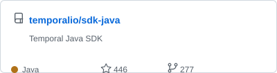
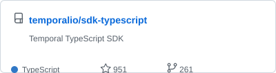
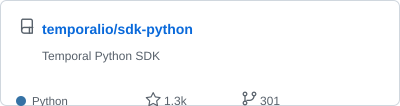
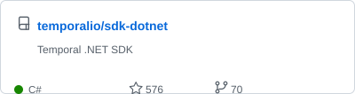
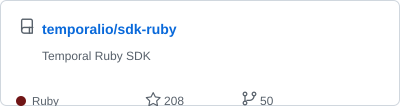
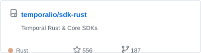

**Temporal** delivers an open-source [Durable Execution](https://temporal.io/blog/what-is-durable-execution) platform that abstracts away the complexity of building scalable, reliable distributed systems. It presents a development abstraction that preserves complete application state, enabling your application to automatically overcome crashes and service outages. In the case of a hardware failure, it can seamlessly migrate execution to another machine.

## Developing with Temporal
Temporal allows you to code for resilience in your applications and eliminates complex failure and error handling logic in your code, so you can focus on what matters – delivering reliable systems, faster. 

More explicitly, Temporal accelerates development by eliminating the need to write custom code for timers, event sourcing, state checkpointing, retries, and timeouts. It also simplifies your infrastructure by eliminating the need for queues, pub/sub systems, and schedulers. 

## Temporal Adopters
Thousands of companies use Temporal today for both mission-critical and basic workloads. Some of these innovative organizations include Stripe, Netflix, Datadog, HashiCorp, Alaska Airlines, Box, and many more. Typical use cases for Temporal include service orchestration, transaction processing, infrastructure management, async tasks, and job scheduling. 

Every message on Twilio, every Coinbase transaction, and every Snap story uses Temporal.

## Resources
- [Website](https://temporal.io/)
- [Getting to know Temporal](https://youtu.be/wIpz4ioK0gI) (video)
- [Getting Started](https://learn.temporal.io/getting_started/) (tutorials)
- [Slack Community](https://t.mp/slack) 
- [Documentation](https://docs.temporal.io/)
- [Temporal Code Exchange](https://temporal.io/code-exchange)

## Featured Repositories

<a href="https://github.com/temporalio/sdk-go" style="text-decoration: none"><picture><source media="(prefers-color-scheme: dark)" srcset="https://raw.githubusercontent.com/temporalio/.github/profile-cards/sdk-go-dark-v3.svg"><source media="(prefers-color-scheme: light), (prefers-color-scheme: no-preference)" srcset="https://raw.githubusercontent.com/temporalio/.github/profile-cards/sdk-go-light-v3.svg"></picture></a>
<a href="https://github.com/temporalio/sdk-java" style="text-decoration: none"><picture><source media="(prefers-color-scheme: dark)" srcset="https://raw.githubusercontent.com/temporalio/.github/profile-cards/sdk-java-dark-v3.svg"><source media="(prefers-color-scheme: light), (prefers-color-scheme: no-preference)" srcset="https://raw.githubusercontent.com/temporalio/.github/profile-cards/sdk-java-light-v3.svg"></picture></a>

<a href="https://github.com/temporalio/sdk-typescript" style="text-decoration: none"><picture><source media="(prefers-color-scheme: dark)" srcset="https://raw.githubusercontent.com/temporalio/.github/profile-cards/sdk-typescript-dark-v3.svg"><source media="(prefers-color-scheme: light), (prefers-color-scheme: no-preference)" srcset="https://raw.githubusercontent.com/temporalio/.github/profile-cards/sdk-typescript-light-v3.svg"></picture></a>
<a href="https://github.com/temporalio/sdk-python" style="text-decoration: none"><picture><source media="(prefers-color-scheme: dark)" srcset="https://raw.githubusercontent.com/temporalio/.github/profile-cards/sdk-python-dark-v3.svg"><source media="(prefers-color-scheme: light), (prefers-color-scheme: no-preference)" srcset="https://raw.githubusercontent.com/temporalio/.github/profile-cards/sdk-python-light-v3.svg"></picture></a>

<a href="https://github.com/temporalio/sdk-dotnet" style="text-decoration: none"><picture><source media="(prefers-color-scheme: dark)" srcset="https://raw.githubusercontent.com/temporalio/.github/profile-cards/sdk-dotnet-dark-v3.svg"><source media="(prefers-color-scheme: light), (prefers-color-scheme: no-preference)" srcset="https://raw.githubusercontent.com/temporalio/.github/profile-cards/sdk-dotnet-light-v3.svg"></picture></a>
<a href="https://github.com/temporalio/sdk-ruby" style="text-decoration: none"><picture><source media="(prefers-color-scheme: dark)" srcset="https://raw.githubusercontent.com/temporalio/.github/profile-cards/sdk-ruby-dark-v3.svg"><source media="(prefers-color-scheme: light), (prefers-color-scheme: no-preference)" srcset="https://raw.githubusercontent.com/temporalio/.github/profile-cards/sdk-ruby-light-v3.svg"></picture></a>

<a href="https://github.com/temporalio/sdk-rust" style="text-decoration: none"><picture><source media="(prefers-color-scheme: dark)" srcset="https://raw.githubusercontent.com/temporalio/.github/profile-cards/sdk-rust-dark-v3.svg"><source media="(prefers-color-scheme: light), (prefers-color-scheme: no-preference)" srcset="https://raw.githubusercontent.com/temporalio/.github/profile-cards/sdk-rust-light-v3.svg"></picture></a>
<a href="https://github.com/temporalio/sdk-php" style="text-decoration: none"><picture><source media="(prefers-color-scheme: dark)" srcset="https://raw.githubusercontent.com/temporalio/.github/profile-cards/sdk-php-dark-v3.svg"><source media="(prefers-color-scheme: light), (prefers-color-scheme: no-preference)" srcset="https://raw.githubusercontent.com/temporalio/.github/profile-cards/sdk-php-light-v3.svg"></picture></a>

<a href="https://github.com/temporalio/cli" style="text-decoration: none"><picture><source media="(prefers-color-scheme: dark)" srcset="https://raw.githubusercontent.com/temporalio/.github/profile-cards/cli-dark-v3.svg"><source media="(prefers-color-scheme: light), (prefers-color-scheme: no-preference)" srcset="https://raw.githubusercontent.com/temporalio/.github/profile-cards/cli-light-v3.svg"></picture></a>
<a href="https://github.com/temporalio/ai-cookbook" style="text-decoration: none"><picture><source media="(prefers-color-scheme: dark)" srcset="https://raw.githubusercontent.com/temporalio/.github/profile-cards/ai-cookbook-dark-v3.svg"><source media="(prefers-color-scheme: light), (prefers-color-scheme: no-preference)" srcset="https://raw.githubusercontent.com/temporalio/.github/profile-cards/ai-cookbook-light-v3.svg"></picture></a>

